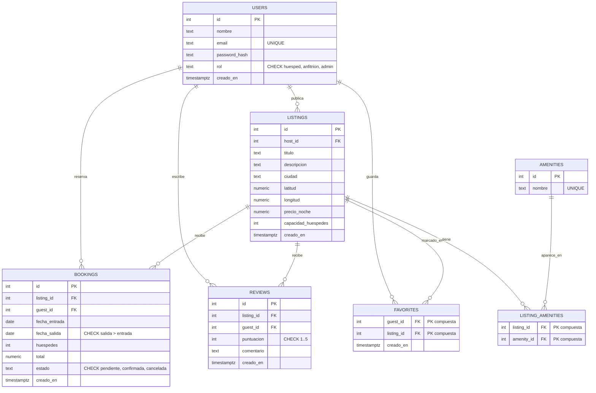

# PRD — Quedate

> Documento de requisitos del producto (Product Requirements Document).
> Borrador del Sprint 0 (historia H0.3). La aprobación del profesor se pide en un Issue.

| Campo | Valor |
| --- | --- |
| Alumno | Layan Olivero |
| Proyecto n.º | 20 |
| Sitio de referencia | Airbnb — https://www.airbnb.com |
| Compañero revisor | (pendiente: se publica antes del mar 17 nov 2026) |
| URL desplegada | (se completa en el Sprint 5) |

## 1. Problema

En Venezuela y Latinoamérica las ofertas de alquiler vacacional están dispersas en WhatsApp, Instagram y grupos: no existe un solo lugar donde ver qué alojamientos están libres para unas fechas, cuánto cuestan y dónde están en un mapa. El viajero pierde horas preguntando disponibilidad por chat, y el anfitrión pierde reservas por responder tarde o por no tener sus fechas organizadas. Quedate centraliza la oferta: el viajero filtra por fechas y ve solo lo disponible, con precio y ubicación.

## 2. Usuarios

- **Usuario principal: el viajero (huésped).** Busca una estadía corta (fin de semana, vacaciones) desde el celular. Necesita encontrar rápido un lugar disponible para sus fechas, ver fotos, precio por noche y ubicación, y reservar sin tener que chatear con nadie.
- **Usuario secundario: el anfitrión.** Publica sus alojamientos (casa, apartamento, cabaña), fija precio por noche y capacidad, y gestiona sus reservas y reseñas desde su panel.
- **Administrador (sistema):** modera el catálogo. Sin panel propio en el MVP: se gestiona directo en la base.

## 3. Objetivo y métrica de éxito

Un viajero encuentra un alojamiento disponible para sus fechas en menos de 1 minuto, y el filtro por fechas nunca muestra un alojamiento ya reservado en ese rango. Éxito del MVP: 10 reservas de prueba creadas sin choques de fechas y sin errores en la búsqueda con 10.000 alojamientos cargados.

## 4. Alcance del MVP

1. Catálogo de alojamientos con foto, precio por noche, ciudad y capacidad.
2. Búsqueda con filtro por rango de fechas: solo alojamientos disponibles en esas fechas.
3. Mapa con los alojamientos del resultado (marcadores; al elegir uno se abre su detalle).
4. Detalle de alojamiento con fotos, servicios, calendario de disponibilidad y reseñas.
5. Reserva con rango de fechas, número de huéspedes y cálculo del total (noches × precio).
6. Registro e inicio de sesión con roles (huésped y anfitrión).
7. Publicación y gestión de alojamientos por el anfitrión; reseñas y favoritos.

### Funcionalidades → carpetas de `src/` (screaming architecture)

| Funcionalidad | Carpeta |
| --- | --- |
| Alojamientos (catálogo, detalle, publicación) | `src/listings` |
| Reservas (crear, ver, cancelar) | `src/bookings` |
| Usuarios y roles | `src/users` |
| Reseñas y puntuación | `src/reviews` |
| Favoritos | `src/favorites` |

## 5. Fuera de alcance

- Pagos en línea: la reserva se confirma sin cobrar; el pago se acuerda fuera de la plataforma.
- Mensajería en tiempo real entre huésped y anfitrión.
- Verificación de identidad de usuarios.
- App móvil nativa (la web es responsive, móvil primero).
- Cancelaciones con reembolso automático.
- Multi-idioma y multi-moneda (precios en USD).

## 6. Requisitos funcionales

| ID | Requisito | Prioridad |
| --- | --- | --- |
| RF-01 | Ver el catálogo de alojamientos con foto, precio por noche, ciudad y capacidad | alta |
| RF-02 | Filtrar por rango de fechas: solo alojamientos disponibles en ese rango | alta |
| RF-03 | Filtrar por ciudad, precio máximo y número de huéspedes | alta |
| RF-04 | Ver los alojamientos del resultado en un mapa con marcadores | alta |
| RF-05 | Ver el detalle de un alojamiento con fotos, servicios y disponibilidad | alta |
| RF-06 | Crear una reserva con rango de fechas y huéspedes | alta |
| RF-07 | Calcular el total de la reserva (noches × precio por noche) | alta |
| RF-08 | Cancelar una reserva propia | media |
| RF-09 | Registrarse e iniciar sesión (rol huésped o anfitrión) | alta |
| RF-10 | Publicar un alojamiento (solo anfitrión) | alta |
| RF-11 | Editar o eliminar un alojamiento propio (solo anfitrión) | media |
| RF-12 | Dejar una reseña y una puntuación de 1 a 5 en un alojamiento donde me hospedé | media |
| RF-13 | Guardar y quitar alojamientos de favoritos | media |
| RF-14 | Ver mis reservas (huésped) y mis alojamientos con sus reservas (anfitrión) | media |

## 7. Requisitos no funcionales

- Responsive, móvil primero (375 px y 1280 px).
- Lighthouse ≥ 90 en Accesibilidad y Buenas prácticas.
- 0 errores en la consola del navegador.
- Funciona con 10.000 registros sin congelarse.
- La base nunca acepta dos reservas confirmadas que se solapen en el mismo alojamiento: el solapamiento se valida en el repositorio antes de insertar (en el Sprint 4 se evalúa una `exclusion constraint` con `btree_gist`).
- Las consultas de disponibilidad usan índices en `bookings (listing_id, fecha_entrada, fecha_salida)`.

## 8. Modelo de datos

7 tablas: `users`, `listings`, `bookings`, `reviews`, `favorites` y `amenities` + `listing_amenities`. Dos relaciones muchos-a-muchos: usuario ↔ alojamiento (favoritos) y alojamiento ↔ servicio (servicios del alojamiento).



Notas de diseño:
- Las fechas se guardan como `date` (sin hora): una reserva ocupa las noches desde `fecha_entrada` hasta `fecha_salida` (la salida no se duerme).
- `REVIEWS` lleva `UNIQUE (listing_id, guest_id)`: un huésped reseña un alojamiento una sola vez.
- Las contraseñas se guardan como hash, nunca en texto plano.
- Las semillas del proyecto cargan ciudades reales de Venezuela (Caracas, Valencia, Maracay, Mérida, Margarita, Los Roques) con precios en USD.

## 9. Reto técnico distintivo

**Filtro por rango de fechas (intervalos) + mapa (H9.1).**

Disponibilidad: dos intervalos `[entrada, salida)` se solapan si `entrada < salida_otra AND entrada_otra < salida`. Un alojamiento está libre para `[E, S)` cuando no existe ninguna reserva confirmada que se solape:

```sql
SELECT * FROM listings l
WHERE NOT EXISTS (
  SELECT 1 FROM bookings b
  WHERE b.listing_id = l.id
    AND b.estado = 'confirmada'
    AND b.fecha_entrada < $2   -- salida buscada
    AND $1 < b.fecha_salida    -- entrada buscada
);
```

Mapa: Leaflet + OpenStreetMap (gratis, sin clave de API). Cada marcador es un alojamiento del resultado filtrado; al hacer clic se abre su detalle. El mapa y la lista comparten el mismo filtro, así que al cambiar las fechas se actualizan los dos a la vez. Periférico (H6.3): la geolocalización del navegador (`navigator.geolocation`) centra el mapa en "alojamientos cerca de mí". Visualización (H7.1): gráfico propio en Canvas/SVG con la ocupación o los precios por ciudad (sin librerías de gráficos).

## 10. Riesgos y preguntas abiertas

- **Fotos:** no se pueden copiar fotos de Airbnb. Se usarán fotos propias, de Unsplash con licencia libre o marcadores de posición hasta tener fotos reales.
- **Mapa sin clave de pago:** Leaflet + OpenStreetMap es gratis, pero hay que confirmar con el profesor que una librería de mapas no choca con la regla de "sin librerías" del H7.1 (esa regla es para gráficos, no para mapas).
- **Concurrencia:** dos personas reservando las mismas fechas al mismo tiempo. El MVP valida el solapamiento antes de insertar; la transacción con bloqueo se revisa en el Sprint 4.
- **Datos de prueba realistas:** precios y ciudades de Venezuela; las 10.000 semillas deben parecer alojamientos reales, no filas repetidas.
- **¿El filtro de fechas también bloquea reservas pendientes o solo confirmadas?** Decisión del borrador: solo las confirmadas bloquean; las pendientes expiran. A confirmar con el profesor.
