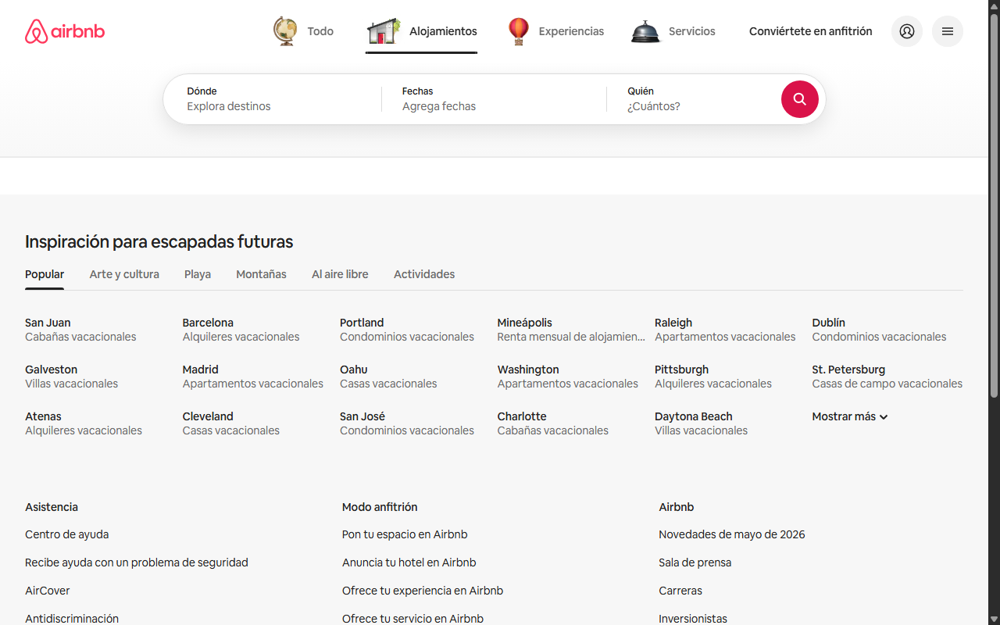
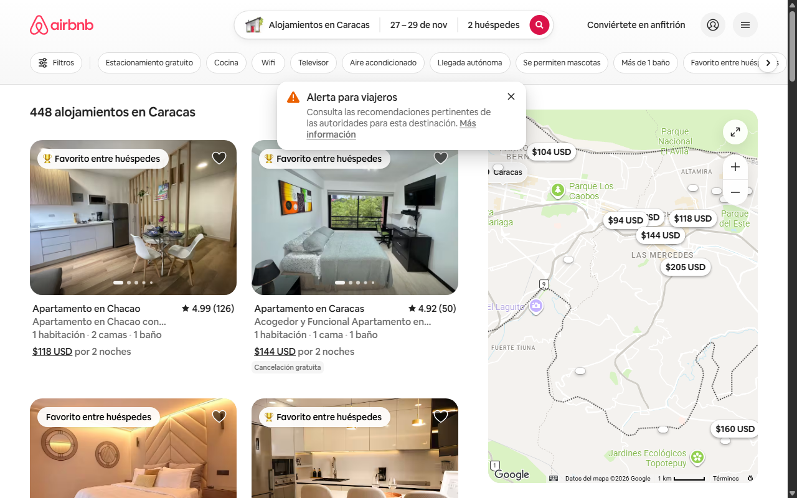
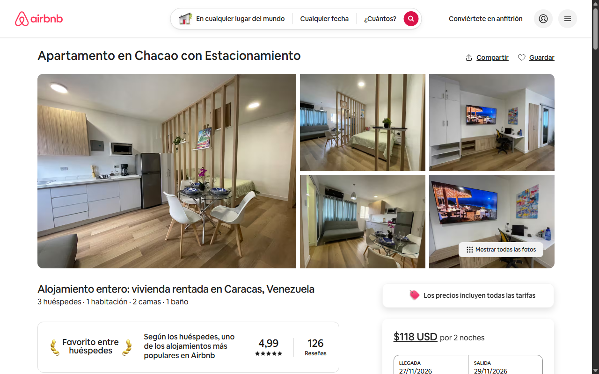
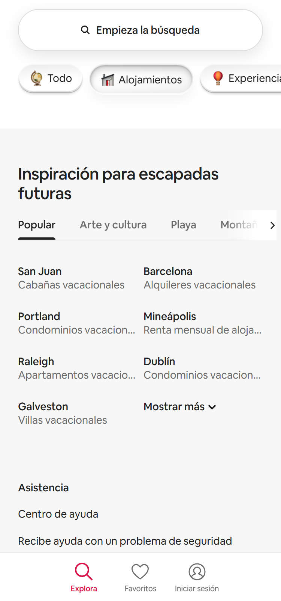

# Ingeniería inversa — Airbnb (para Quedate)

> Historia H1.1 · Sprint 1 · Fecha del análisis: 21 nov 2026
> Sitio analizado: https://www.airbnb.com (redirige a https://www.airbnb.co.ve/)
> Búsqueda de ejemplo: Caracas, 27–29 nov 2026, 2 huéspedes

## 1. Página de inicio

**Hallazgo 1 — Redirección y localización.** `airbnb.com` redirige a `airbnb.co.ve`.
Idioma: Español (VE). Moneda: $ / USD. El sitio se adapta al país del visitante.

**Hallazgo 2 — Estructura de la página.** Enlace "Omite el contenido" (salto de accesibilidad),
encabezado "Página de inicio de Airbnb", pestañas Todo (seleccionada), Alojamientos,
Experiencias y Servicios. Buscador con tres campos — Dónde ("Explora destinos"), Fechas
("Agrega fechas"), Quién ("¿Cuántos?") — y botón Buscar. Navegación de perfil:
"Conviértete en anfitrión", "Iniciar sesión o registrarse" y menú principal.

**Hallazgo 3 — Contenido personalizado por búsqueda previa.** Tras haber buscado, muestra
"Sigue explorando Caracas · 27 – 29 de nov" y carruseles: "Sugerencias basadas en tu
búsqueda en Caracas" (1–7 de 9 elementos), "Quédate cerca de Petare", "Quédate en Catia
la Mar", "Alojamientos populares cerca de Maracay", cada uno con "Ver todo".

**Hallazgo 4 — Sección de inspiración y pie de página.** "Inspiración para escapadas
futuras" con pestañas Popular, Arte y cultura, Playa, Montañas, Al aire libre y
Actividades. El pie tiene tres columnas: Asistencia (Centro de ayuda, AirCover,
Antidiscriminación, Apoyo para discapacitados, Opciones de cancelación), Modo anfitrión
(Pon tu espacio en Airbnb, AirCover para anfitriones, Recursos para anfitrionar, Centro
de la comunidad) y Airbnb (Novedades, Sala de prensa, Carreras, Inversionistas), más
"© 2026 Airbnb, Inc.", Privacidad, Términos, idioma, moneda y redes sociales.

**Hallazgo 5 — Diseño visual observado (valores verificados en la sección 4).** Fondo blanco,
texto #222222, acento rosa/rojo en el logotipo (#FF385C) y en el botón de búsqueda
(degradado radial, muestra #DA1249). Tarjetas con fotos grandes de esquinas muy
redondeadas, etiqueta blanca "Favorito entre huéspedes" sobre la foto y corazón de
favoritos arriba a la derecha. Aviso persistente: "Los precios incluyen todas las tarifas".
Ejemplos (2 noches): "Apartamento en Chacao" $118 USD, 4.99; "Apartamento en El Rosal"
$144 USD, 4.92; "Apartamento en Caracas" $205 USD, 5.0; "Habitación en Sabana Grande"
$94 USD, 5.0.

## 2. Resultados de búsqueda

URL usada: `https://www.airbnb.co.ve/s/Caracas--Venezuela/homes?checkin=2026-11-27&checkout=2026-11-29&adults=2`

**Hallazgo 6 — El estado de la búsqueda vive en la URL.** Destino, fechas y huéspedes van
como parámetros: `checkin`, `checkout`, `adults`, en la ruta `/s/Caracas--Venezuela/homes`.
Los filtros, el mapa y la paginación no se reflejan en la URL en esta visita.

**Hallazgo 7 — Filtros y vista.** Mismo header compacto, pestañas Alojamientos /
Experiencias / Servicios, filtros Precio, Tipo de lugar, Habitaciones y camas y Más
filtros, más el interruptor "Mostrar el precio total antes de impuestos". Encabezado:
"471 alojamientos en Caracas". Paginación: "1–18 de más de 1,000 alojamientos".

**Hallazgo 8 — Mapa con pines de precios.** A la derecha, un mapa (Google Map) con pines
que muestran el precio: $50, $58, $63, $68, $73, $75, $79, $80, $84, $85, $89, $91, $94,
$95, $100, $102, $105, $106, $110, $118, $131, $142, $144, $152, $156, $160, $168, $176,
$186, $189, $193, $204, $205, $212, $227, $260 USD.

**Hallazgo 9 — Contenido de la tarjeta.** Foto, precio por 2 noches, calificación y número
de reseñas, habitaciones/camas/baños. Ejemplos: "Apartamento en Chacao" $118 USD por 2
noches, 4.99 (126 reseñas), 1 habitación, 2 camas, 1 baño; "Apartamento en Caracas"
$144 USD por 2 noches, 4.92 (49 reseñas).

## 3. Detalle de alojamiento

URL: `https://www.airbnb.co.ve/rooms/1451747204879997849?adults=2&check_in=2026-11-27&check_out=2026-11-29&search_mode=regular_search&federated_search_id=3b7c22ec-6af3-41d4-a77d-8ec7f4cb4ff4`
(Anuncio: "Apartamento en Chacao con Estacionamiento", ID 1451747204879997849.)

**Hallazgo 10 — Estructura del detalle.** H1 con el título del anuncio, botones Compartir
y Guardar, galería de 5 fotos con textos alternativos escritos por el anfitrión
("Nuestra área de comedor te invita a disfrutar de una comida rápida y caliente…",
"En ésta cama descansaras como un rey y reina. Es tamaño Queen y el colchón está Nuevo.")
y "Mostrar todas las fotos". Datos: "Alojamiento entero: vivienda rentada en Caracas,
Venezuela", "3 huéspedes · 1 habitación · 2 camas · 1 baño", "Favorito entre huéspedes",
"Calificación de 4,99 sobre 5 estrellas", "126 reseñas".

**Hallazgo 11 — Ficha del anfitrión y servicios.** Anfitrión César, "Superanfitrión",
"3 años anfitrionando", 184 reseñas, 4.99 de 5, "Índice de respuesta: 100%",
"Responde en menos de una hora", coanfitriona Jyoti Angelica. Destacados: "En el 1% de
los alojamientos mejor valorados", "Estacionamiento gratuito y lavandería en la unidad".
Servicios (31 en total): Cocina, Wifi, Zona de trabajo privada, Estacionamiento
residencial gratuito, Televisión, Ascensor, Lavadora y Secadora gratis. Declara que NO
tiene detector de monóxido de carbono ni detector de humo.

**Hallazgo 12 — Calendario y tarjeta de reserva.** Calendario de noviembre/diciembre
2026: "2 noches en Caracas", "27 de nov. de 2026 - 29 de nov. de 2026". Tarjeta de
reserva: "$118 USD por 2 noches", LLEGADA 27/11/2026, SALIDA 29/11/2026, "2 huéspedes",
botón Reserva, "No se hará ningún cargo por el momento". Reseñas: 5 estrellas general
(99% 5 estrellas, 1% 4 estrellas), 5.0 en limpieza, exactitud, check-in, comunicación,
ubicación y precio; temas mencionados: Ubicación 67, Hospitalidad 76, Limpieza 34,
Comodidad 24. Reglas: check-in 3:00 p.m. a 9:00 p.m., check-out antes de las 10:00 a.m.,
"Cancelación gratuita antes de las 3:00 p.m. del 22 de noviembre". Ruta de navegación:
Airbnb > Venezuela > Miranda > Chacao.

**Hallazgo 13 — Seguimiento entre búsqueda y detalle.** El mismo `federated_search_id`
aparece en la URL de búsqueda y en la del detalle: el sitio sigue la sesión de búsqueda
con ese identificador, además de `source_impression_id` y `previous_page_section_name`.

## 4. Sistema de diseño, red, almacenamiento y rendimiento (verificado con CDP, 23 nov 2026)

**Hallazgo 14 — Tipografía.** Familia: "Airbnb Cereal VF", Circular, -apple-system,
BlinkMacSystemFont, Roboto, "Helvetica Neue", sans-serif. Base 14 px. H1 de inicio 28 px /
peso 700; H1 de detalle 26 px / peso 500. Precio en resultados 15 px / peso 500; precio
en detalle 22 px / peso 500 y "por 2 noches" 16 px / peso 400. La fuente variable se
descarga como `AirbnbCerealVF_W_Wght.woff2` desde `a0.muscache.com`. En la página de
resultados también se cargan Google Sans y Roboto (las trae el mapa de Google).

**Hallazgo 15 — Colores (medidos).** Texto principal #222222 (estilo computado y muestra
de píxel), fondo #FFFFFF (body) y #F7F7F7 en las secciones. Logo #FF385C (píxel más
saturado del área del logo en la captura). Botón de búsqueda: degradado radial rosa/rojo,
muestra medida #DA1249 en el centro del círculo.

**Hallazgo 16 — Red y formato de datos.** Los datos llegan como JSON desde
`https://www.airbnb.co.ve/api/v2/` y `/api/v3/` con consultas nombradas estilo GraphQL:
`get-data-layer-variables`, `NaviServerAnnouncementsQuery`, `PromotionsByPlacementsQuery`,
`Header`, `client_configs`, además de `/tracking/jitney/logging/messages`. Los archivos
estáticos (JS, CSS, fuentes) se sirven desde `a0.muscache.com`; las fotos desde
`a0.muscache.com/im/pictures/`; también se cargan `manifest.json` y `tags.js` de
`d0a7e.airbnb.com`.

**Hallazgo 17 — Dónde guarda estado.** En la URL: destino, fechas y huéspedes (hallazgo 6)
más `federated_search_id` y `source_impression_id` (hallazgo 13). En localStorage:
`explore_satori_market`, `map_feature_settings`, `_gcl_ls`,
`jitney_page_name_/s/Caracas--Venezuela/homes`, `/v2/get-data-layer-variables/...` y
`navi_announcements_impressions_logged_out`. En sessionStorage: `tab-tracking-v2-tabId`,
`tab-tracking-v2-lockSessionStorage`, `tab-tracking-v2-timestamp`,
`__search_map_visited_items`. Cookies: 12 en inicio y 18 en búsqueda/detalle, entre ellas
`_user_attributes` (con `curr: USD`), `bev`, `everest_cookie` y `previousTab`.

**Hallazgo 18 — Rendimiento medido (23 nov 2026).** Inicio: DOMContentLoaded 1132 ms, load
1233 ms, primer pintado 684 ms. Búsqueda: DOMContentLoaded 625 ms, load 2186 ms, primer
pintado 280 ms. Detalle: DOMContentLoaded 621 ms, load 1051 ms, primer pintado 312 ms. El
conteo de resultados es dinámico: en dos visitas seguidas el mismo buscador mostró 471 y
luego 448 alojamientos.

**Hallazgo 19 — Vista móvil (375 px).** El inicio colapsa a una sola barra "Empieza la
búsqueda", las pestañas pasan a píldoras horizontales (Todo, Alojamientos,
Experiencias…), "Inspiración para escapadas futuras" se muestra en 2 columnas y aparece
una barra inferior con Explora, Favoritos e Iniciar sesión.

## 5. Problemas detectados (candidatos para H1.3)

1. **Títulos de tarjetas genéricos y repetidos (accesibilidad).** "Apartamento en Caracas"
   aparece 9 veces y "Habitación en Caracas" varias veces en la misma página, sin nombre
   distintivo del anuncio. Un lector de pantalla o un usuario no puede distinguirlos sin
   abrirlos.
2. **Etiquetas de favoritos incorrectas (accesibilidad).** En la tarjeta "Habitación en
   Sabana Grande" el botón dice "Guardar en favoritos: Habitación en Caracas", y lo mismo
   en una tarjeta "Apartamento en Los Dos Caminos" cuyo botón dice "Guardar en favoritos:
   Apartamento en Caracas".
3. **Mezcla de idiomas (UX).** Las pestañas de inicio se leen "No se ha podido reproducir
   el contenido multimedia. Todo / Alojamientos / Experiencias / Servicios"; los botones
   del carrusel mezclan inglés y español ("Previous in … showing 1–7 of 9 items" y
   "Siguiente en … se muestran 1–7 de 9 elementos"); los días del calendario están en
   inglés ("1, Sunday, November 2026"); en el detalle hay un enlace "Show more about
   this place" junto a "Mostrar más".
4. **Conteos contradictorios (UX).** El encabezado visible dice "471 alojamientos en
   Caracas", el árbol de accesibilidad dice "Over 1,000 stays" y la paginación "1–18 de
   más de 1,000 alojamientos".
5. **Una alerta modal bloquea la interacción (UX).** En resultados aparece un diálogo
   ("Parece que no hay suficientes resultados para mostrarlos en el mapa") que cubre las
   tarjetas y rechaza el clic hasta cerrarlo. En el mapa, los pines se solapan (por
   ejemplo, $152 USD queda parcialmente tapado por $118 USD).
6. **Carga inicial con contenido vacío (rendimiento).** La página principal carga primero
   con el contenido principal vacío (esqueleto) y las pestañas informan "No se ha podido
   reproducir el contenido multimedia": el contenido multimedia/iconos no cargó en esta
   sesión.
7. **Pérdida de contexto en el detalle (UX).** Aunque la URL lleva check_in, check_out y
   adults, el buscador del header se resetea a "En cualquier lugar del mundo / Cualquier
   fecha / ¿Cuántos?"; solo la tarjeta de reserva conserva las fechas. En el calendario,
   el 28 de noviembre está deshabilitado con "El mínimo es de 2 noches" y el 29 con
   "Fecha de salida seleccionada" pero también deshabilitado, lo que es confuso.
8. **Controles solo con icono y aviso de seguridad (accesibilidad).** Varios controles son
   solo iconos sin texto visible (corazón de favoritos, flechas del carrusel). El anuncio
   declara que no tiene detector de humo ni de monóxido de carbono.

## 6. Pendiente

- [ ] Lighthouse "antes" sobre airbnb.com (para H1.3). Se corre en Chrome DevTools,
      pestaña Lighthouse, sobre la página de inicio y una de resultados.
- [ ] Copiar las 4 capturas a `docs/img/` con estos nombres: `01-inicio.png`,
      `02-resultados.png`, `03-detalle.png`, `04-inicio-movil.png` (las referencias de
      este documento ya apuntan ahí). Las capturas ya fueron tomadas el 23 nov 2026 con
      Chrome en la PC; solo falta copiarlas al repo al crear el PR.

## 7. Qué se lleva Quedate de este análisis

- El estado de la búsqueda va en la URL (destino, fechas, huéspedes): el clon y el
  producto real deben hacer lo mismo.
- La tarjeta muestra foto, precio por noche, calificación y capacidad: es el formato que
  replica el catálogo de Quedate.
- El mapa y la lista comparten el mismo resultado: en Quedate ambos se actualizan con el
  mismo filtro de fechas (reto H9.1).
- Los 3 problemas a corregir en H1.3 salen de la sección 4; los propuestos son los
  números 1, 3 y 5 (títulos y etiquetas accesibles únicos, todo en español, y sin modal
  que bloquee ni pines solapados).
